<div align="center">

# PerformIQ

### Employee Performance & Growth Management System

An enterprise modular monolith for high-velocity organizations to manage performance review cycles, OKRs, 360° multi-rater feedback, career development pathways, and tamper-evident audit trails.

[](https://openjdk.org/)
[](https://spring.io/projects/spring-boot)
[](https://www.postgresql.org/)
[](https://react.dev/)
[](https://www.typescriptlang.org/)
[](https://tailwindcss.com/)
[](backend)
[](LICENSE)

[Features](#key-features) • [Quick Start](#quick-start) • [Demo Accounts](#demo-personas--role-access) • [Architecture](#architecture) • [Business Rules](#core-business-logic) • [Project Structure](#project-structure)

</div>

---

## Overview

**PerformIQ** bridges high-level organizational OKRs with ground-level career development. Engineered with strict relational constraints, transactional business rules, and an append-only audit ledger, PerformIQ provides complete traceability across the employee review lifecycle.

```mermaid
flowchart LR
    A[Review Cycle<br/>DRAFT] --> B[Cycle Active<br/>Goal Setting]
    B --> C[Check-Ins &<br/>Key Result Updates]
    C --> D[360 Feedback<br/>Self, Peer, Manager]
    D --> E[Review Scoring<br/>60% OKR + 40% Feedback]
    E --> F[Development Plan<br/>Approval Workflow]
    F --> G[Cycle Closed<br/>Audit Sealed]
    
    style A fill:#e2e8f0,stroke:#64748b,stroke-width:1px
    style B fill:#dbeafe,stroke:#3b82f6,stroke-width:1px
    style C fill:#ede9fe,stroke:#8b5cf6,stroke-width:1px
    style D fill:#fce7f3,stroke:#ec4899,stroke-width:1px
    style E fill:#fef3c7,stroke:#f59e0b,stroke-width:1px
    style F fill:#d1fae5,stroke:#10b981,stroke-width:1px
    style G fill:#f1f5f9,stroke:#475569,stroke-width:1px
```



---

## Key Features

- **Goal & OKR Progress Cascade**: Key Results support both `INCREASE` and `DECREASE` metric types with zero-division safeguards, normalized progress bounds [0, 100]%, and real-time weighted aggregation into parent goals.
- **Cycle Weight Constraint**: Enforces a strict $\sum \le 100\%$ total goal weight per employee per review cycle.
- **360° Multi-Rater Feedback**: Self, Manager, Peer, and Upward feedback collection with 8 standardized competency rubrics and multi-dimensional scoring summaries.
- **Composite Review Scoring**: Mathematically balanced formula blending 60% OKR Goal Achievement and 40% Multi-Rater Feedback.
- **Two-Phase Development Plan Approvals**: State machine workflow (`DRAFT -> SUBMITTED -> APPROVED / REJECTED -> IN_PROGRESS -> COMPLETED`) with mandatory coaching justification on rejections.
- **Append-Only SOC2 Audit Ledger**: Transactional state mutation logging with a JSON side-by-side state diff inspector.
- **Synthetic Data & Anomaly Injection**: Python Faker generator producing 7,489 benchmark records with SHA-256 manifest verification and 10 calibrated anomaly test cases.

---

## Quick Start

### 1. In-Memory Mode (Zero Docker Setup)

Run the entire platform locally without external database installation:

```bash
# Terminal 1: Backend (Spring Boot with In-Memory PostgreSQL H2 compatibility)
cd backend
./mvnw spring-boot:run "-Dspring-boot.run.profiles=local"
```

```bash
# Terminal 2: Frontend (React 19 + Vite 6)
cd frontend
npm run dev
```

- **Web Application**: `http://localhost:5173`
- **REST API**: `http://localhost:8080/api/v1`
- **Swagger UI**: `http://localhost:8080/api/v1/swagger-ui.html`

---

### 2. Production Docker Mode

For production environments with containerized PostgreSQL 17:

```bash
# Start PostgreSQL Container
docker compose up -d

# Run Backend (Flyway automatically executes migrations V2 & V3)
cd backend
./mvnw spring-boot:run

# Run Frontend
cd frontend
npm run dev
```

---

## Demo Personas & Role Access

PerformIQ provides a **1-Click Demo Persona Switcher** on the login page and top navigation bar. Every persona is pre-configured with the default password: `password123`.

| Persona | Role | Username | Department | Scope of Responsibility |
| :--- | :--- | :--- | :--- | :--- |
| **Platform Admin** | `ADMIN` | `admin` | People Operations | Full system governance, batch ingestion, review cycle state transitions, SOC2 audit trail |
| **Sarah Chen** | `MANAGER` | `sarah.chen` | Engineering | VP of Engineering: team overview, composite performance scoring studio, plan approvals |
| **Marcus Vance** | `MANAGER` | `marcus.vance` | Engineering | Director of Engineering: direct report coaching, mandatory rejection reason workflows |
| **Elena Rostova** | `EMPLOYEE` | `elena.rostova` | Engineering | Staff Software Engineer: interactive OKR sliders, check-in evidence, 360 feedback hub |
| **Alex Rivera** | `EMPLOYEE` | `alex.rivera` | Engineering | Senior Staff Engineer: technical milestones, career development roadmap |

---

## Architecture

PerformIQ employs a **Modular Monolith** architecture organized package-by-feature under `com.performiq.*`:

```
PerformIQ/
├── backend/                        # Spring Boot 4.1.2 + Java 21 Monolith
│   ├── src/main/java/com/performiq/
│   │   ├── audit/                  # Audit trail and event logging
│   │   ├── auth/                   # JWT provider, security filter, auth endpoints
│   │   ├── checkin/                # Periodic check-ins and progress snapshots
│   │   ├── common/                 # Global exceptions, base entities, utilities
│   │   ├── competency/             # Core competency rubrics
│   │   ├── config/                 # Security, OpenAPI, and profile configs
│   │   ├── dataimport/             # Topological CSV/JSON batch ingestion
│   │   ├── development/            # Career growth plans & approval state machine
│   │   ├── employee/               # Profiles, directory, and organizational tree
│   │   ├── evidence/               # Deliverables, URLs, and code PR attachments
│   │   ├── feedback/               # 360 multi-rater feedback matrix
│   │   ├── goal/                   # OKR goals, cycle weight validator, history
│   │   ├── keyresult/              # Metric calculations and cascade math
│   │   ├── manager/                # Manager hierarchy and assignment history
│   │   ├── review/                 # Performance reviews and composite ratings
│   │   ├── reviewcycle/            # Bi-annual review cycles and state pipeline
│   │   └── validation/             # Domain rule checks and anomaly audit
│   └── src/main/resources/
│       ├── db/migration/           # Flyway DDL (V2) & Demo Seed (V3)
│       ├── application.yaml        # PostgreSQL production configuration
│       └── application-local.yaml  # Zero-docker H2 in-memory profile
├── frontend/                       # React 19 + TypeScript + Vite 6
│   ├── src/
│   │   ├── components/layout/      # Sidebar, Navbar, and persona switcher
│   │   ├── context/                # Authentication context and token management
│   │   ├── pages/                  # 12 role-specific enterprise views
│   │   ├── services/               # Axios client with interceptors
│   │   └── types/                  # TypeScript domain models matching backend DTOs
│   └── package.json
├── data-generator/                 # Python 3.12+ Synthetic Data Generator
│   ├── generator/                  # DAG dependency generator & anomaly injector
│   └── output/                     # Generated benchmark datasets & signed manifest
├── docs/                           # Architecture, schema, and API documentation
└── docker-compose.yml              # PostgreSQL 17 container definition
```

---

## Core Business Logic

### 1. Key Result Metric Mathematics

Key Result progress is computed depending on the metric orientation and clamped to `[0, 100]%`:

- **INCREASE Metric** (e.g., test coverage from 60% to 90%):
  $$\text{Progress} = \left(\frac{V_{\text{current}} - V_{\text{start}}}{V_{\text{target}} - V_{\text{start}}}\right) \times 100$$

- **DECREASE Metric** (e.g., API latency from 250ms to 45ms):
  $$\text{Progress} = \left(\frac{V_{\text{start}} - V_{\text{current}}}{V_{\text{start}} - V_{\text{target}}}\right) \times 100$$

- **Cascade to Parent Goal**:
  $$\text{Goal Progress} = \frac{\sum_{i=1}^{n} (\text{Progress}_i \times \text{Weight}_i)}{\sum_{i=1}^{n} \text{Weight}_i}$$

### 2. Cycle Weight Constraint

The total weight of active goals for an employee within a review cycle must satisfy:

$$\sum_{j=1}^{m} \text{Goal Weight}_j \le 100.00\%$$

Attempts to exceed 100% are rejected with an explicit `BadRequestException`.

### 3. Review Scoring Blend

Official cycle scores combine OKR execution and competency feedback:

$$\text{Final Score} = \left(0.60 \times \text{Average Goal Score}\right) + \left(0.40 \times \text{Average 360 Feedback}\right)$$

---

## Testing & Quality Assurance

### Automated Backend Test Suites

```bash
cd backend
./mvnw test
```

- `BusinessLogicCalculationTest`: OKR math, zero-division safeguards, composite scoring formulas, and 360 feedback aggregation.
- `BusinessLogicIntegrationTest`: Database constraints, cycle weight bounds ($\le 100\%$), review cycle state transitions, and plan approval state machine.
- `RestApiSecurityAndEndpointsTest`: Authentication token issuance, RBAC endpoint protection, employee profile fetching, and API contracts.

**Result**: 15 / 15 tests passing (0 failures, 0 errors).

---

## Documentation

- [Database Schema & ER Topology](docs/database_schema.md)
- [Data Dictionary & Entity Models](docs/data_dictionary.md)
- [REST API Specification](docs/api_specification.md)
- [Core Business Logic Rules](docs/business_logic.md)
- [Synthetic Data Generation & Anomaly Model](docs/synthetic_data_generation.md)
- [Data Quality & Validation Engine](docs/data_validation.md)
- [Engineering Log & Decision Records](docs/prompt_history.md)

---

## License

This project is licensed under the MIT License — see the [LICENSE](LICENSE) file for details.
