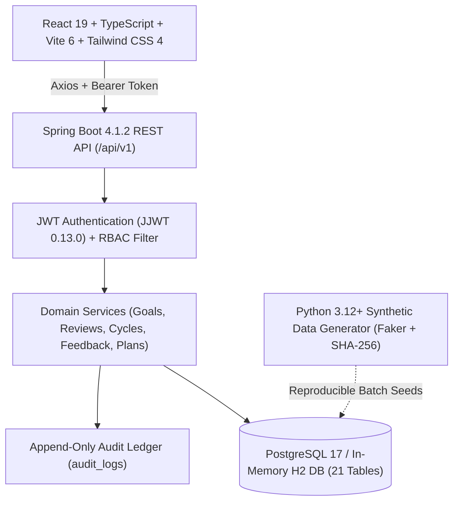

# PerformIQ — Employee Performance & Growth Management System

PerformIQ is an enterprise-grade employee performance and career growth platform built with a modular monolith architecture in Java 21 / Spring Boot 4 and React 19 / TypeScript. It delivers mathematically verified OKR goal tracking, 360° feedback multi-dimensional aggregation, structured career development workflows, and tamper-evident audit logging.

---

## 1. Quick Start

PerformIQ supports two launch modes:
1. **Zero-Docker In-Memory Mode** (Instant evaluation — boots in under 10 seconds with zero external database dependencies).
2. **PostgreSQL Production Mode** (Docker-backed containerized database with Flyway schema migrations).

### Option A: Zero-Docker In-Memory Mode (Recommended for Instant Evaluation)

#### Terminal 1 — Start the Backend (H2 PostgreSQL Compatibility Mode)
```powershell
cd d:\PerformIQ\backend
.\mvnw.cmd spring-boot:run "-Dspring-boot.run.profiles=local"
```
*API Base URL*: `http://localhost:8080/api/v1`  
*Interactive Swagger UI*: `http://localhost:8080/api/v1/swagger-ui.html`

#### Terminal 2 — Start the Frontend (Vite 6 + React 19)
```powershell
cd d:\PerformIQ\frontend
npm run dev
```
*Web Application*: `http://localhost:5173/`

---

### Option B: PostgreSQL Production Mode (Docker)

```powershell
# 1. Start PostgreSQL 17 Container
cd d:\PerformIQ
docker compose up -d

# 2. Start Backend with Flyway Migrations
cd d:\PerformIQ\backend
.\mvnw.cmd spring-boot:run

# 3. Start Frontend
cd d:\PerformIQ\frontend
npm run dev
```

---

## 2. Demo Personas & Pre-Configured Test Accounts

The web application includes a **Demo Persona Switcher** on the login page and top navigation bar. You can authenticate as any role instantly with zero credential friction:

| Demo Persona | Role | Username | Password | Key Showcase Responsibilities |
| :--- | :--- | :--- | :--- | :--- |
| **Platform Admin** | `ADMIN` | `admin` | `password123` | System ingestion, 10 synthetic anomaly quality audit, Review cycle state machine transitions, SOC2 security audit trail |
| **Sarah Chen** | `MANAGER` | `sarah.chen` | `password123` | VP of Engineering: Organization team view, composite review scoring studio, multi-level plan approvals |
| **Marcus Vance** | `MANAGER` | `marcus.vance` | `password123` | Director of Engineering: Direct report score coaching, mandatory rejection comment workflows |
| **Elena Rostova** | `EMPLOYEE` | `elena.rostova` | `password123` | Staff Software Engineer: Interactive OKR sliders with progress cascade, check-in evidence, 360 feedback hub |
| **Alex Rivera** | `EMPLOYEE` | `alex.rivera` | `password123` | Senior Staff Engineer: Architecture initiatives, individual growth plan milestones |

*All accounts share the default password `password123`.*

---

## 3. Architecture & Technology Stack



| Layer | Technology | Version | Purpose |
| :--- | :--- | :--- | :--- |
| **Backend** | Java | `21 (LTS)` | Modern virtual-thread capable runtime |
| **Framework** | Spring Boot | `4.1.2` | Core modular monolith architecture |
| **Security** | Spring Security + JJWT | `0.13.0` | Stateless token authentication with RBAC |
| **Database** | PostgreSQL / H2 | `17.x` | Relational database with strict foreign key constraints |
| **Migrations** | Flyway | `11.x` | Version-controlled DDL and seed scripts |
| **Frontend** | React + TypeScript | `19.3 / 7.0` | Strict type safety and modern concurrent UI |
| **Bundler & Style** | Vite + Tailwind CSS | `8.x / 4.x` | Instant HMR and design token aesthetics |
| **Synthetic Data** | Python + Faker | `3.12+` | Topological data generator with SHA-256 signing |

---

## 4. Key Business Logic & Algorithms

### 1. Key Result Metric Math & Progress Cascade
Key Results track progress on a normalized $[0, 100]\%$ scale depending on metric orientation:

$$\text{INCREASE Metric: } P = \frac{V_{\text{current}} - V_{\text{start}}}{V_{\text{target}} - V_{\text{start}}} \times 100$$

$$\text{DECREASE Metric: } P = \frac{V_{\text{start}} - V_{\text{current}}}{V_{\text{start}} - V_{\text{target}}} \times 100$$

- Safeguarded against zero-division errors when $V_{\text{start}} = V_{\text{target}}$.
- Clamped strictly to $[0, 100]\%$ to prevent negative progress or metric runaway.
- Automatically cascades to parent Goal progress based on relative KR weighting:

$$P_{\text{goal}} = \frac{\sum_{i=1}^{n} (P_{\text{KR}_i} \times W_i)}{\sum_{i=1}^{n} W_i}$$

### 2. OKR Cycle Weight Constraint
- An employee cannot exceed a total weight of $100\%$ across active goals in any single review cycle:

$$\sum_{j=1}^{m} W_{\text{goal}_j} \le 100.00\%$$

- Any attempt to create or update goals beyond $100\%$ is rejected with HTTP 400.

### 3. Review Scoring Formula
The final employee cycle score uses a standardized 60/40 weighted blend:

$$\text{Composite Score} = (0.60 \times \text{Average Goal Score}) + (0.40 \times \text{Average 360 Feedback Rating})$$

### 4. Review Cycle State Machine
Strict lifecycle progression enforced in `ReviewCycleService.java`:
$$\text{DRAFT} \longrightarrow \text{ACTIVE} \longrightarrow \text{UNDER\_REVIEW} \longrightarrow \text{CLOSED}$$

---

## 5. Synthetic Data Generator & 10 Anomaly Benchmarks

The Python data generator (`data-generator/generate.py`) generates **7,489 enterprise records** across 21 domain entities with a cryptographically signed SHA-256 manifest.

### Benchmark Anomaly Detection Cases
PerformIQ purposefully injects 10 calibrated anomaly test cases into the synthetic benchmark dataset to validate the platform's audit and validation rules:

| Anomaly ID | Issue Type | Severity | Affected Entity | Expected Behavior / Detection Rule |
| :--- | :--- | :--- | :--- | :--- |
| `ANOM-001` | `CYCLE_WEIGHT_OVERFLOW` | `HIGH` | `Goal` | Total goal weights exceed 100% in a single cycle |
| `ANOM-002` | `SELF_FEEDBACK_SUBMITTED_AS_PEER` | `MEDIUM` | `Feedback` | Reviewer and employee IDs match on peer evaluation |
| `ANOM-003` | `NEGATIVE_PROGRESS` | `MEDIUM` | `KeyResult` | Metric current value exceeds baseline boundaries |
| `ANOM-004` | `CHECKIN_CANCELLED_GOAL` | `HIGH` | `CheckIn` | Check-in logged against cancelled or terminated goal |
| `ANOM-005` | `UNAPPROVED_PLAN_IN_PROGRESS` | `HIGH` | `DevelopmentPlan` | Plan transitioned to `IN_PROGRESS` without manager approval |
| `ANOM-006` | `CIRCULAR_MANAGER_HIERARCHY` | `CRITICAL` | `Manager` | Cycle detected in reporting tree |
| `ANOM-007` | `FEEDBACK_OUTSIDE_CYCLE_DATES` | `LOW` | `Feedback` | Feedback timestamp outside start/end boundary |
| `ANOM-008` | `ORPHAN_EVIDENCE_ATTACHMENT` | `MEDIUM` | `Evidence` | Evidence referencing non-existent check-in |
| `ANOM-009` | `TRANSITION_CLOSED_CYCLE` | `CRITICAL` | `ReviewCycle` | Mutation attempted on closed cycle |
| `ANOM-010` | `COMPOSITE_SCORE_OUT_OF_BOUNDS`| `HIGH` | `Review` | Composite rating outside normalized $[1.0, 5.0]$ scale |

Evaluators can inspect and verify all 10 anomaly cases in the **Data Ingestion & Quality Studio** (`/admin/data-import`).

---

## 6. Frontend Features & Page Guide

The frontend application consists of 12 responsive enterprise pages:

1. **Login Page (`/login`)**: 1-click recruiter evaluation persona switcher with pre-configured credentials.
2. **Executive Dashboard (`/dashboard`)**: Active review cycle status, KPI summary widgets, direct reports overview, and quick-action bar.
3. **Goals & OKRs Studio (`/goals`)**: Interactive Key Result progress sliders with live cascade calculation, weight badges, and goal creation modal.
4. **Check-In Timeline (`/check-ins`)**: Chronological check-in activity ledger with attached deliverable evidence links and progress snapshots.
5. **360° Feedback Hub (`/feedback`)**: Self, peer, manager, and upward feedback matrices with competency rubric sliders.
6. **Career Development Plans (`/development-plans`)**: Structured growth objectives, skills to improve, target milestones, and historical approval audit trail.
7. **Team Overview (`/team`)**: Manager-exclusive direct report roster, hierarchy relationships, and coaching pathways.
8. **Review Scoring Studio (`/reviews`)**: Manager grading canvas with live 60% OKR + 40% Feedback composite score calculation.
9. **Plan Approvals Center (`/plan-approvals`)**: Direct report plan approval pipeline with mandatory coaching comments for rejections.
10. **Data Ingestion & Quality Studio (`/admin/data-import`)**: Dataset scale inspector, manifest checksum validator, and the 10 benchmark anomaly audit table.
11. **Review Cycle Control Manager (`/admin/review-cycles`)**: Visual state machine pipeline (`DRAFT -> ACTIVE -> UNDER_REVIEW -> CLOSED`) with transition audit logging.
12. **Security & Audit Trail (`/admin/audit-logs`)**: SOC2-compliant append-only activity ledger with searchable entity filters and a **JSON State Diff Inspector** modal showing previous vs. new values.
13. **Organization Directory (`/directory`)**: Searchable company directory with department filters, reporting lines, and quick-view profile modal.

---

## 7. Testing & Verification Results

### Backend Automated Test Suites
Run all backend tests:
```powershell
cd d:\PerformIQ\backend
.\mvnw.cmd test
```
**Results**: `Tests run: 15, Failures: 0, Errors: 0, Skipped: 0`
- `BusinessLogicCalculationTest`: OKR Increase/Decrease metric mathematics, zero-division safeguards, composite review scoring formulas, and 360 feedback aggregation.
- `BusinessLogicIntegrationTest`: Database constraints, cycle weight bounds ($\le 100\%$), review cycle state transitions, and plan approval state machine.
- `RestApiSecurityAndEndpointsTest`: Authentication token issuance, RBAC endpoint protection, employee profile fetching, and API contracts.

### Full End-to-End Lifecycle Verification Suite
Run the automated lifecycle verification script:
```powershell
powershell -ExecutionPolicy Bypass -File scratch/test_complete_lifecycle.ps1
```
**Results**:
- `[1/6]` Authenticated Elena Rostova with signed JWT token.
- `[2/6]` Retrieved active goal and measurable Key Results.
- `[3/6]` Updated KeyResult value -> KeyResult progress updated to $85.00\%$ and cascaded parent goal progress to $80.21\%$.
- `[4/6]` Created check-in note with progress snapshot on active goal.
- `[5/6]` Authenticated Manager Marcus Vance and approved pending development plan.
- `[6/6]` Authenticated Admin and verified tamper-evident audit ledger entries.

---

## 8. License & Authorship

PerformIQ — Employee Performance & Growth Management Platform. Licensed under the MIT License. Developed as an enterprise modular monolith reference architecture.
# PerformIQ

