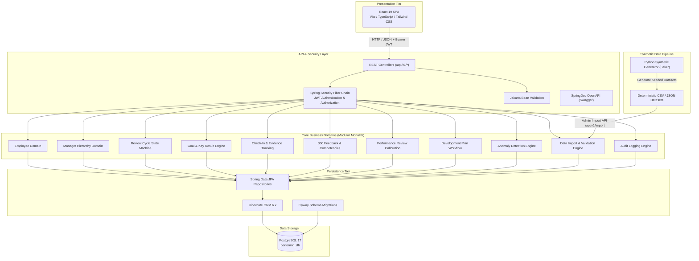

# PerformIQ — System Architecture Document

## 1. System Overview

**PerformIQ** is an enterprise-grade Employee Performance & Growth Management System. It is engineered as a **modular monolith** in Java 21 / Spring Boot 4.1.2 with a React 19 + TypeScript frontend and a PostgreSQL 17 relational persistence tier.

The platform unifies:
1. Employee directory and temporal managerial reporting hierarchies
2. Bi-annual / quarterly review cycles with strict lifecycle state machines
3. Goal setting & OKRs with weighted progress calculations derived from measurable Key Results
4. Periodic check-ins with supporting evidence attachments
5. 360-degree feedback with rubric-based competency evaluations
6. Formal performance reviews with rating calibration
7. Post-review development plans governed by multi-step approval workflows
8. Anomaly detection, data quality monitoring, and system-wide audit logging
9. File-based data ingestion pipeline with cryptographic manifest verification

---

## 2. Technology Stack & Design Decisions

| Tier | Component | Technology / Version | Rationale |
|------|-----------|----------------------|-----------|
| **Runtime** | JVM | Eclipse Temurin JDK 21 | Modern LTS Java featuring virtual threads, pattern matching, and record patterns |
| **Backend** | Framework | Spring Boot 4.1.2 | High performance, modular architecture, Spring Data JPA, Jakarta EE 11 |
| **Database** | Relational Store | PostgreSQL 17 | Robust ACID transactions, JSONB capability, pgcrypto, check constraints |
| **Migration**| DB Versioning | Flyway | Reproducible, version-controlled database schema migrations |
| **Security** | Auth & RBAC | Spring Security + JJWT 0.13 | Stateless token authentication, role-based authorization |
| **Frontend** | SPA Framework | React 19 + Vite 6 | Fast HMR, concurrent mode, modern component ergonomics |
| **Language** | Type Safety | TypeScript 5.8 | End-to-end typed DTOs and component contracts |
| **Styling**  | Design System | Tailwind CSS 4 + Lucide Icons | Clean modern enterprise design system with responsive layouts |
| **Data Gen** | Synthetic Data | Python 3.12+ / Faker | Deterministic, reproducible synthetic dataset generation |

---

## 3. High-Level Architecture



---

## 4. Modular Monolith Architecture

The codebase enforces strict domain boundaries inside `com.performiq.*`:

```
com.performiq/
├── PerformiqBackendApplication.java
├── config/                        # SecurityConfig, CorsConfig, OpenApiConfig
├── common/                        # BaseEntity, GlobalExceptionHandler, ErrorResponse
│   ├── entity/
│   ├── exception/
│   └── dto/
├── auth/                          # Authentication, JWT Filter, UserDetails, AppUser
├── employee/                      # Employee lifecycle & profile management
├── manager/                       # Manager hierarchy & reporting histories
├── reviewcycle/                   # Review cycle state machine (DRAFT -> CLOSED)
├── goal/                          # Goals, progress derivation, change history
├── keyresult/                     # Metric calculations (INCREASE/DECREASE), weights
├── checkin/                       # Periodic check-in submissions
├── evidence/                      # Check-in artifact attachments (URL, METRIC, DOC)
├── competency/                    # Catalog of organizational competencies
├── feedback/                      # Multi-rater feedback & rubric evaluations
├── review/                        # Formal reviews & goal score aggregations
├── development/                   # Development plans & approval histories
├── audit/                         # Security & operational audit logging
├── validation/                    # Anomaly case catalog and data quality checks
├── dataimport/                    # Batch CSV/JSON ingestion engine
└── analytics/                     # Dashboard metric aggregations
```

---

## 5. Security & Authorization Matrix

The application uses stateless JWT bearer tokens with standard Role-Based Access Control:

| Role | Permissions & Boundaries |
|------|--------------------------|
| **EMPLOYEE** | Read own profile; create/manage own goals; submit check-ins; submit self & assigned peer feedbacks; view own completed reviews and development plans. |
| **MANAGER** | All employee capabilities; view direct reports; conduct manager evaluations; score reviews for direct reports; approve/reject development plans. |
| **HR_PARTNER** | View organization-wide review cycles; initiate review cycles; monitor completion percentages; view aggregate ratings and distribution charts. |
| **OPERATIONS** | System health monitoring; trigger and inspect synthetic data import runs; view anomaly detection reports and validation discrepancies. |
| **ADMIN** | Full system governance; manage user accounts; override review cycle states; purge/reload test environments; inspect complete audit logs. |
