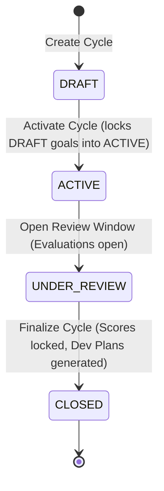
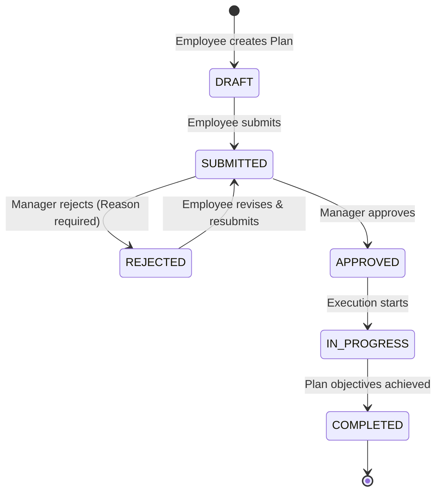

# PerformIQ — Core Business Logic Architecture & Specification

## 1. Executive Summary
This document specifies the core domain business rules, mathematical calculation engines, state machines, and approval workflows implemented in **PerformIQ**. The design prioritizes domain model integrity, zero-division safeguards, strict monotonic state transitions, and audit trail traceability over simple CRUD operations.

---

## 2. Goal Management & Progress Calculation Engine

### 2.1 Key Result Progress Calculation
Key results track progress using one of two metric directions: `INCREASE` or `DECREASE`.

#### Mathematical Formulation:
1. **Increase Metric (`MetricType.INCREASE`)**:
   $$\text{Progress} = \frac{\text{current\_value} - \text{start\_value}}{\text{target\_value} - \text{start\_value}} \times 100$$
   - *Zero-Division Safeguard*: If $\text{target\_value} == \text{start\_value}$, then $\text{Progress} = 100.00\%$ if $\text{current\_value} \ge \text{target\_value}$, else $0.00\%$.

2. **Decrease Metric (`MetricType.DECREASE`)** (e.g., API latency, defect leakage, MTTR):
   $$\text{Progress} = \frac{\text{start\_value} - \text{current\_value}}{\text{start\_value} - \text{target\_value}} \times 100$$
   - *Zero-Division Safeguard*: If $\text{start\_value} == \text{target\_value}$, then $\text{Progress} = 100.00\%$ if $\text{current\_value} \le \text{target\_value}$, else $0.00\%$.

3. **Clamping & Precision**:
   $$\text{Progress}_{\text{clamped}} = \max(0.00, \min(100.00, \text{Progress}))$$
   - All progress values are clamped to the range $[0.00\%, 100.00\%]$ and rounded to 2 decimal places using `RoundingMode.HALF_UP`.

### 2.2 Parent Goal Progress Cascade
When a Key Result's current value is updated:
1. The Key Result's progress is recomputed using the above formula.
2. A `KeyResultHistory` audit entry is created with `old_value` and `new_value`.
3. The parent `Goal` progress is automatically recomputed as a weighted average across all child Key Results:
   $$\text{Goal Progress} = \frac{\sum_{i=1}^n (\text{progress}_i \times \text{weight}_i)}{\sum_{i=1}^n \text{weight}_i}$$
4. If child Key Results do not exist, direct progress updates are permitted via Check-ins.
5. If Goal progress reaches $100.00\%$, the Goal transitions automatically to `COMPLETED`.

### 2.3 Goal Weight Constraints
For an employee within a specific review cycle:
$$\sum_{g \in \text{Goals}_{\text{cycle}}} \text{weight}_g \le 100.00\%$$
- Any attempt to create or increase a goal's weight beyond $100.00\%$ triggers a `BadRequestException`.

---

## 3. Review Cycle State Machine

Review cycles progress monotonically through four distinct phases:

### Transition Invariants:
- **`DRAFT -> ACTIVE`**: Cycle start date reached. All employee `DRAFT` goals for this cycle are automatically activated (`ACTIVE`).
- **`ACTIVE -> UNDER_REVIEW`**: Active execution ends; 360 evaluations (Self, Manager, Peer, Upward) and formal performance reviews commence.
- **`UNDER_REVIEW -> CLOSED`**: All performance ratings, scores, and evaluations are finalized. Further reviews or feedback submissions are strictly rejected.
- **Illegal Transitions**: Backward transitions (e.g., `CLOSED -> ACTIVE`, `ACTIVE -> DRAFT`) throw a `BadRequestException`.
- **Optimistic Concurrency**: Review cycles use Hibernate `@Version` to prevent concurrent race conditions during status transitions.

---

## 4. 360° Feedback Submission & Aggregation Engine

### 4.1 Evaluation Roles & Feedback Types
- **`SELF`**: Self-evaluation. Strict constraint: `reviewer_id == employee_id`.
- **`MANAGER`**: Manager evaluation. Reviewer must be an active manager in the reporting line.
- **`PEER`**: Lateral peer feedback. Constraint: `reviewer_id != employee_id`.
- **`UPWARD`**: Subordinate feedback for manager. Constraint: `reviewer_id != employee_id`.

### 4.2 Rating Rubric & Submission Rules
- All overall ratings and individual competency scores must be integers strictly within $[1, 5]$.
- Once submitted, feedback transitions from `DRAFT` to `SUBMITTED` with `submitted_at = Instant.now()`.
- Resubmission or editing of submitted feedback is blocked.

### 4.3 Multi-Dimensional Aggregation
The engine produces an aggregated feedback summary:
1. **Average Overall Rating**: Arithmetic mean across all submitted feedbacks.
2. **Breakdown by Feedback Type**: Individual averages for `SELF`, `MANAGER`, `PEER`, and `UPWARD` to surface blind spots.
3. **Competency Score Matrix**: Average rating per competency across all evaluators.

---

## 5. Performance Review Scoring Engine

Each formal performance review produces a composite rating on a scale of $[1.00, 5.00]$:
$$\text{Composite Score} = (0.60 \times \text{Goal Score}) + (0.40 \times \text{360 Feedback Score})$$

- **Goal Score**: Average of scored review goals $[1.00, 5.00]$.
- **Feedback Score**: Aggregated 360 feedback rating from the feedback engine.
- Upon scoring, `status` changes to `COMPLETED` and `completed_at` is stamped.

---

## 6. Development Plan Approval Workflow

### Transition Rules:
1. **Submit (`DRAFT` / `REJECTED -> SUBMITTED`)**: Employee submits the plan for managerial review.
2. **Reject (`SUBMITTED -> REJECTED`)**: Manager rejects the plan. **A non-blank comment is mandatory**; rejecting without feedback triggers `BadRequestException`.
3. **Approve (`SUBMITTED -> APPROVED`)**: Manager approves the objectives and milestones.
4. **Execution (`APPROVED -> IN_PROGRESS -> COMPLETED`)**: Employee activates the plan and logs completion upon reaching the milestones.
5. **Approval History Trail**: Every transition generates a persistent `ApprovalHistory` record documenting the actor, action timestamp, and comments.

---

## 7. Audit Logging Engine

The `AuditService` captures all critical mutations into the `audit_logs` table:
- **`actor`**: The employee initiating the action.
- **`action`**: e.g., `CREATE_GOAL`, `UPDATE_KEY_RESULT_VALUE`, `RECORD_CHECK_IN`, `TRANSITION_CYCLE_STATUS`, `SUBMIT_FEEDBACK`, `COMPLETE_REVIEW`, `APPROVE_DEV_PLAN`.
- **`entity_type`** & **`entity_id`**: Target entity domain and business ID.
- **`previous_value`** & **`new_value`**: State delta or serialized JSON payloads.
- **`reason`**: Explanatory comment or business rationale.
