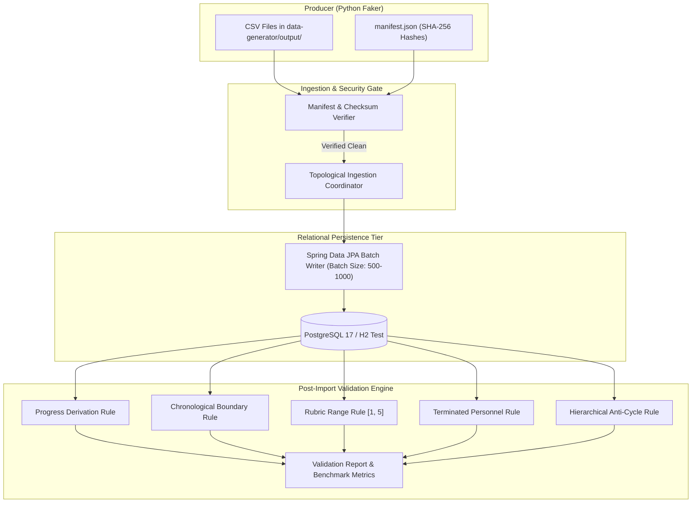

# PerformIQ — Data Import & Validation Engine

## 1. Architectural Overview

The **Data Import & Validation Engine** forms the ingestion and data quality pillar of PerformIQ. It connects the decoupled Python synthetic data generator to the Spring Boot relational persistence tier via an auditable, cryptographically verified file ingestion pipeline.



---

## 2. Ingestion Topological Dependency Order

To strictly guarantee referential integrity without turning off foreign key constraints, ingestion executes in exact directed acyclic graph (DAG) order:

| Step | Entity Collection | Referenced Dependencies |
|:----:|:------------------|:------------------------|
| **1** | `review_cycles` | None |
| **2** | `employees` | None |
| **3** | `managers` | `employees` |
| **4** | `manager_assignment_history` | `employees`, `managers` |
| **5** | `app_users` | `employees` |
| **6** | `goals` | `employees`, `review_cycles` |
| **7** | `key_results` | `goals` |
| **8** | `goal_history` & `key_result_history` | `goals`, `key_results`, `employees` |
| **9** | `check_ins` | `goals`, `employees` |
| **10** | `evidence` | `check_ins` |
| **11** | `feedbacks` | `employees`, `review_cycles` |
| **12** | `feedback_competencies` | `feedbacks`, `competencies` |
| **13** | `reviews` | `employees`, `review_cycles` |
| **14** | `review_goals` | `reviews`, `goals` |
| **15** | `development_plans` | `employees`, `reviews` |
| **16** | `approval_history` | `development_plans`, `employees` |
| **17** | `anomalies` | None (Benchmark Ground Truth) |

---

## 3. Cryptographic Verification Gate

Before reading entity records, `DataImportService` verifies:
1. `manifest.json` exists and matches schema specification version `1.0`.
2. Every CSV file declared in `manifest.files` is present on disk.
3. Every file's SHA-256 digest is calculated on the stream and compared against `file.sha256`.
4. If a file is tampered with, truncated, or missing, the process fails fast with a clear exception, and `data_import_runs.status` is set to `FAILED`.

---

## 4. Business Validation Rules & Formulas

### Rule 1: Goal Progress Derivation Math
- **Formula**:
  $$\text{Expected Progress} = \frac{\sum_{i=1}^{n} (\text{KR}_i.\text{progress} \times \text{KR}_i.\text{weight})}{\sum_{i=1}^{n} \text{KR}_i.\text{weight}}$$
- **Invariant**: $|\text{Actual Progress} - \text{Expected Progress}| \le 0.05$
- **Severity**: `HIGH` (`PROGRESS_CALCULATION_MISMATCH`)

### Rule 2: Chronological Check-in Window
- **Invariant**: $\text{ReviewCycle}.\text{start\_date} \le \text{check\_in\_date} \le \text{ReviewCycle}.\text{end\_date}$
- **Severity**: `MEDIUM` (`CHECKIN_DATE_OUT_OF_BOUNDS`)

### Rule 3: Evaluation Rubric Bounds
- **Invariant**: $\text{rating} \in [1, 5]$ and $\text{overall\_score} \in [0.00, 100.00]$
- **Severity**: `HIGH` (`OUT_OF_RANGE_RATING`)

### Rule 4: Terminated Personnel Separation
- **Invariant**: An employee with $\text{status} = \text{TERMINATED}$ cannot possess any goal with $\text{status} = \text{ACTIVE}$.
- **Severity**: `CRITICAL` (`TERMINATED_EMPLOYEE_ACTIVE_GOAL`)

### Rule 5: Non-Circular Hierarchical Reporting
- **Invariant**: $\text{employee\_id} \ne \text{manager.employee\_id}$
- **Severity**: `CRITICAL` (`CIRCULAR_REPORTING_HIERARCHY`)

---

## 5. Admin API Endpoints

### 1. Trigger Data Import
```http
POST /api/v1/admin/import
Content-Type: application/json

{
  "directoryPath": "../data-generator/output",
  "format": "csv",
  "verifyChecksums": true,
  "runValidation": true
}
```

### 2. Get Validation Quality Report
```http
GET /api/v1/admin/validation/report
```
Example JSON Response:
```json
{
  "totalAnomaliesDetected": 10,
  "benchmarkAnomaliesInjected": 10,
  "detectionRatePercentage": 100.0,
  "anomaliesByType": {
    "PROGRESS_CALCULATION_MISMATCH": 1,
    "CHECKIN_DATE_OUT_OF_BOUNDS": 1,
    "OUT_OF_RANGE_RATING": 1,
    "TERMINATED_EMPLOYEE_ACTIVE_GOAL": 1,
    "CIRCULAR_REPORTING_HIERARCHY": 1,
    "KEY_RESULT_PROGRESS_OUT_OF_BOUNDS": 1,
    "CHECKIN_EMPTY_NOTES": 1,
    "EXCESSIVE_PROGRESS_CLAMP": 3
  },
  "anomaliesBySeverity": {
    "CRITICAL": 2,
    "HIGH": 2,
    "MEDIUM": 2,
    "LOW": 4
  }
}
```
