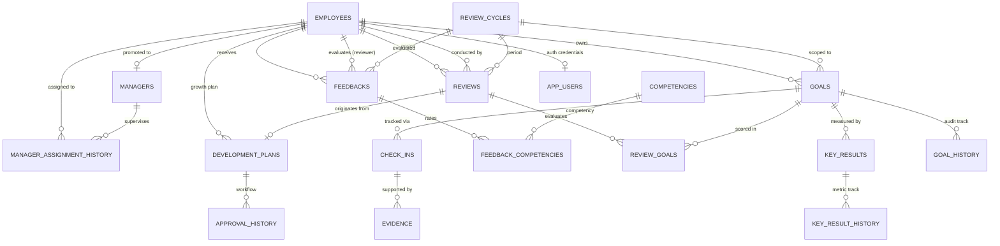

# PerformIQ — Database Schema Documentation

## 1. Overview

PerformIQ uses **PostgreSQL 17** as its core relational database. The schema is organized into 21 normalized tables supporting:
- Core organizational structure (Employees, Managers, Manager Assignment History)
- Performance & OKR lifecycle (Review Cycles, Goals, Key Results, Check-ins, Evidence)
- Competency evaluations & Multi-rater feedback (Competencies, Feedbacks, Feedback-Competencies bridge)
- Formal Performance Reviews & Development Plans (Reviews, Review-Goals bridge, Development Plans, Approval History)
- Auditing, Integrity & Compliance (Audit Logs, Anomaly Cases, Goal History, Key Result History, Data Import Runs, App Users)

All tables use **UUID primary keys** internally for storage efficiency, distribution safety, and relational integrity, while exposing human-readable **Business IDs** (e.g., `EMP-000001`, `CYCLE-2026-H1`, `GOAL-EMP-000001-001`) with unique indexes for user-facing API interactions and import tracking.

---

## 2. Entity-Relationship Diagram

---

## 3. Flyway Migration Versioning

| Migration Version | Description | Purpose |
|-------------------|-------------|---------|
| `V1__baseline.sql` | Pgcrypto extension & baseline check | Confirms DB connection and sets up cryptographic extensions. |
| `V2__initial_schema.sql` | 21 Tables, Foreign Keys, Check Constraints, Indices | Complete DDL for the normalized relational schema. |
| `V3__seed_data.sql` | Core Competencies, 2026-H1 Review Cycle, Seed Users & Passwords | Deterministic seed data for local development and initial testing. |

---

## 4. Key Integrity Rules & Constraints

1. **Foreign Key Integrity**:
   - `ON DELETE RESTRICT` on core references (e.g., deleting an employee assigned as a manager or reviewer is blocked).
   - `ON DELETE CASCADE` for tightly coupled child items (e.g., deleting a goal cascades to its key results and check-ins).
2. **Deterministic Unique Constraints**:
   - `employees(business_id)`, `employees(email)`
   - `managers(business_id)`, `managers(employee_id)`
   - `review_cycles(business_id)`
   - `goals(business_id)`
   - `key_results(business_id)`
   - `competencies(business_id)`, `competencies(name)`
   - `reviews(employee_id, review_cycle_id)` — One formal review per employee per review cycle.
   - `feedback_competencies(feedback_id, competency_id)` — One rating per competency per feedback form.
   - `review_goals(review_id, goal_id)` — One score per goal in a review.
   - `app_users(username)`
3. **Numeric Checks**:
   - `progress`, `progress_snapshot`, `overall_score`, `goal_score`: `CHECK (value >= 0 AND value <= 100)`
   - `weight`: `CHECK (weight >= 0)`
   - `overall_rating`, `rating`: `CHECK (rating >= 1 AND rating <= 5)`
   - `review_cycles`: `CHECK (end_date >= start_date)`
